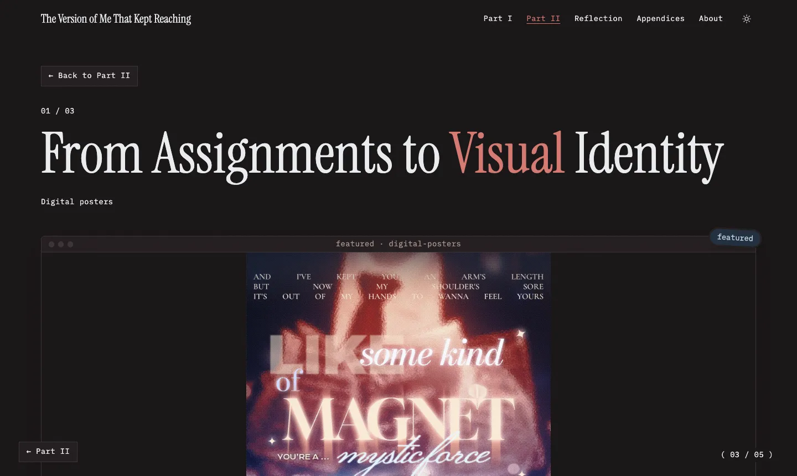

<h1 align="center">The Version of Me That Kept <em>Reaching</em></h1>

<p align="center">
  <strong>a quiet, mystic pull</strong><br />
  A digital art portfolio for GEARTS (Art Appreciation), set up like a small museum you walk through.
</p>

<p align="center">
  <a href="https://quiet-mystic-pull.onrender.com">
    
  </a>
</p>

<p align="center">
  
  
  
  
  
  
</p>

<p align="center">
  <a href="#about">About</a> ·
  <a href="#the-rooms">The Rooms</a> ·
  <a href="#highlights">Highlights</a> ·
  <a href="#tech-stack">Tech Stack</a> ·
  <a href="#run-it-locally">Run It Locally</a>
</p>

<p align="center">
  
</p>

---

## About

> _Perhaps I was never searching for something new, only finding new ways to say what I couldn't before._

This portfolio gathers my GEARTS works and the creations I pursued beyond the classroom. **Part I** reveals an unexpected thread of water and tides woven through my class outputs. **Part II** follows that thread through posters, photographs, and fuzzy-wire lilies, each a new medium for me. It ends with a **reflection**, written as a letter, and **appendices** showing the process behind every Part II work.

**Gio Angelo Lat** · BSIT 3A · GEARTS: Art Appreciation · 2026

## The Rooms

The site is laid out like a museum. Each page is a room, visited in order.

| Room | What's inside |
| --- | --- |
| **Entrance** | The title, an exhibition note, a 3D hallway of highlighted works, and a floor directory |
| **I · My Art Appreciation Journey** | All 9 class outputs, month by month: scribble art, book spine poetry, coffee painting, blackout poetry, painting, and more |
| **II · My Artistic Exploration** | 3 works made beyond the classroom: digital posters, photography, and a fuzzy-wire bouquet |
| **III · Looking Forward: Who Am I Becoming?** | The reflection, written as a letter on paper, with NIKI's "Tsunami" playing alongside it |
| **IV · Appendices** | Process evidence for each Part II work: drafts, screenshots, dates, and links |
| **About me** | A passport-style card, stamps to collect, songs on repeat, and a few favourite things |

## Highlights

- **A museum, not a feed.** Works hang in gilded frames, each wing ends with a "Next Room" plaque, and a counter in the corner shows where you are.
- **One thread throughout.** Water and tides connect the class works, the explorations, and the reflection.
- **A letter with a song.** The reflection floats NIKI's "Tsunami" over the page, like a song sent with a letter.
- **The "Buzz" palette.** Brick red, dusty rose, cream, and cobalt blue, taken from NIKI's _Buzz_ album cover.
- **Light and dark themes.** Warm paper in the day, a night street after dark.
- **Works on phones.** Every page was checked at phone size.
- **Considerate by default.** Alt text on every image, keyboard navigation, and calmer motion when your device asks for reduced motion.

## Tech Stack

| | |
| --- | --- |
| **Framework** | [Astro](https://astro.build), for fast pages built from simple content files |
| **Styling** | [Tailwind CSS](https://tailwindcss.com) |
| **Interactive bits** | [React](https://react.dev), for the fanned cards, spinning badge, and click sparks |
| **Motion** | [GSAP](https://gsap.com), [Motion](https://motion.dev), and [Lenis](https://lenis.darkroom.engineering) for smooth scrolling |
| **3D** | [Three.js](https://threejs.org), for the hallway on the Entrance |
| **Fonts** | Instrument Serif, Newsreader, EB Garamond, Caveat, Geist, IBM Plex Mono |
| **Hosting** | [Render](https://render.com) (static site, updates on every push) |

Each work is a short Markdown file in `src/content/`, so adding or editing a piece doesn't touch any page code.

## Run It Locally

You need [Node.js](https://nodejs.org) 22.23 or newer.

```bash
git clone https://github.com/luxmoncoeur/quiet-mystic-pull.git
cd quiet-mystic-pull
npm install
npm run dev
```

Then open [localhost:4321](http://localhost:4321).

| Command | What it does |
| --- | --- |
| `npm run dev` | Start the site locally |
| `npm run build` | Build the site for publishing (into `dist/`) |
| `npm run preview` | Preview the built site |

---

<p align="center">
  All works in Part II were made by me without AI tools.<br />
  The logos on the pubmats belong to their organizations (FACTS, FSC, and the college); the designs are my own.<br />
  Song embeds belong to NIKI and 88rising.
</p>
